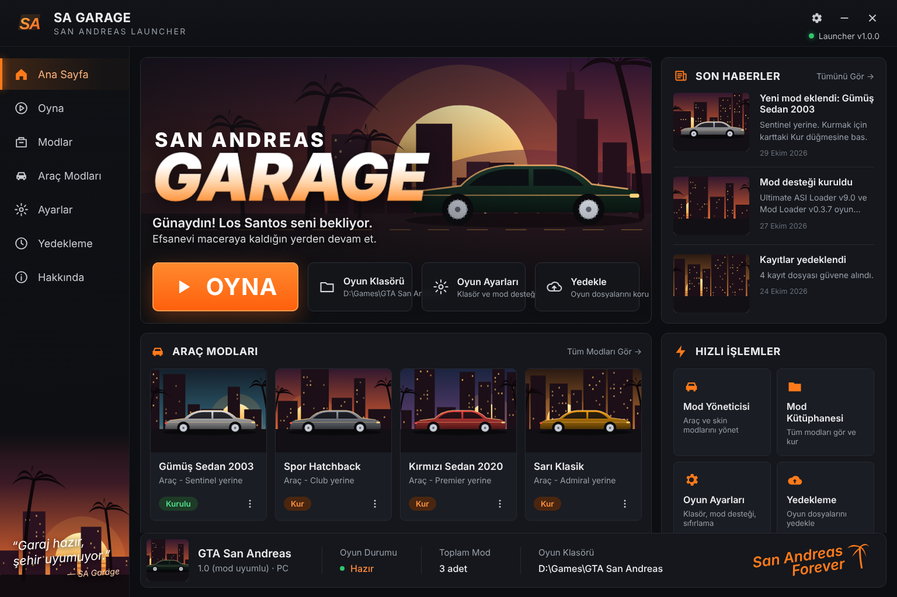
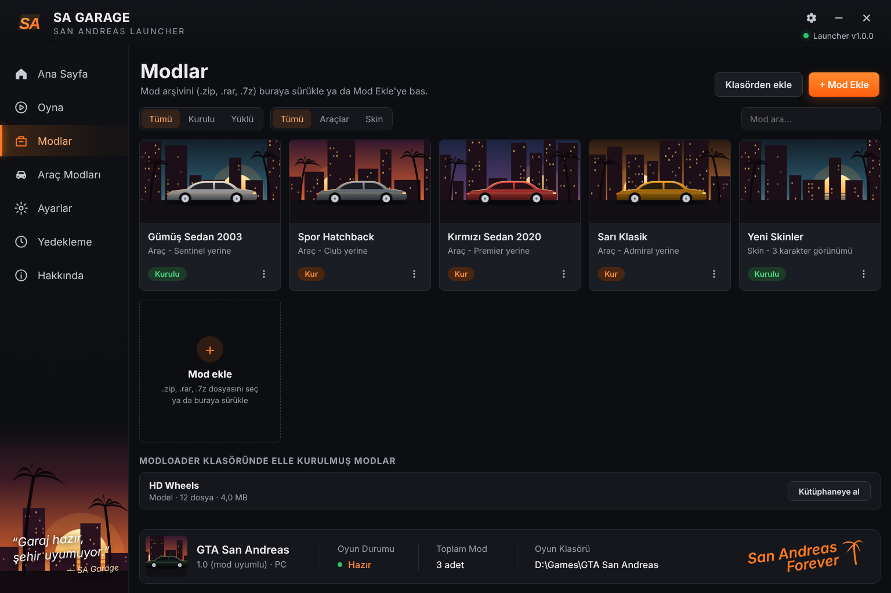
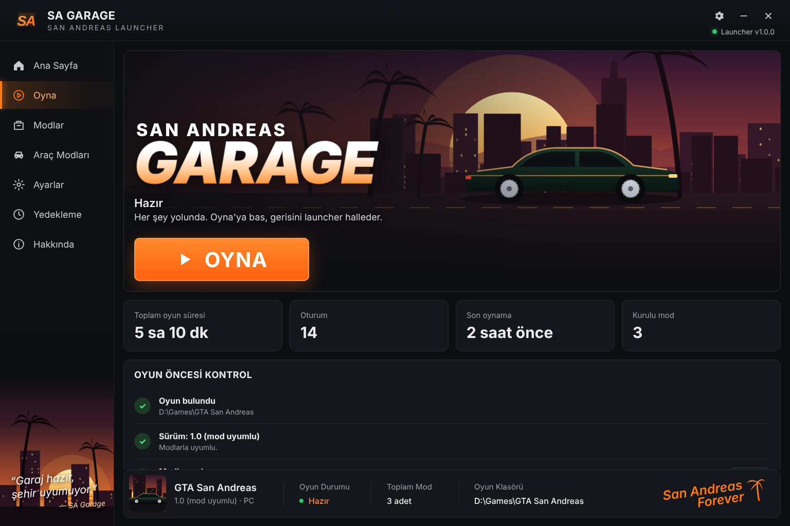
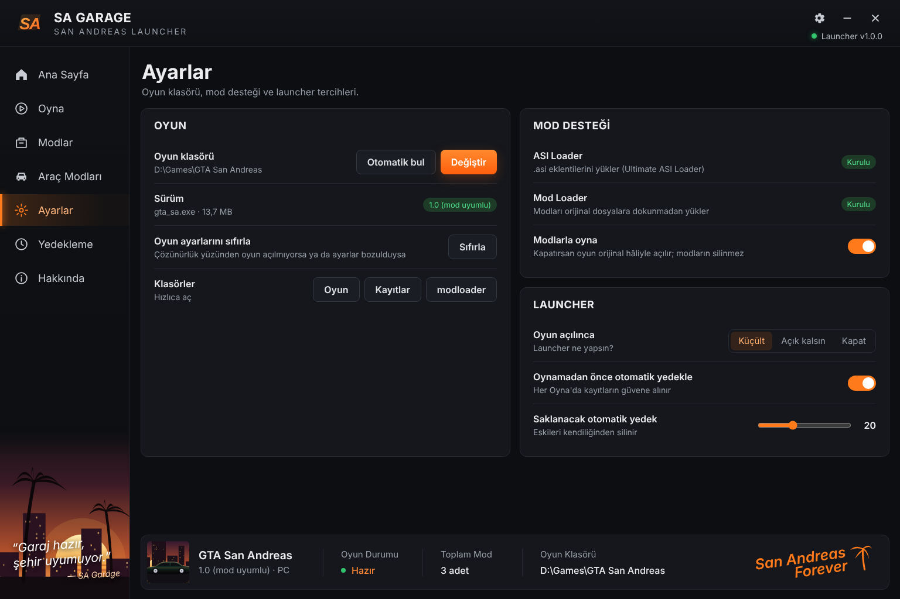
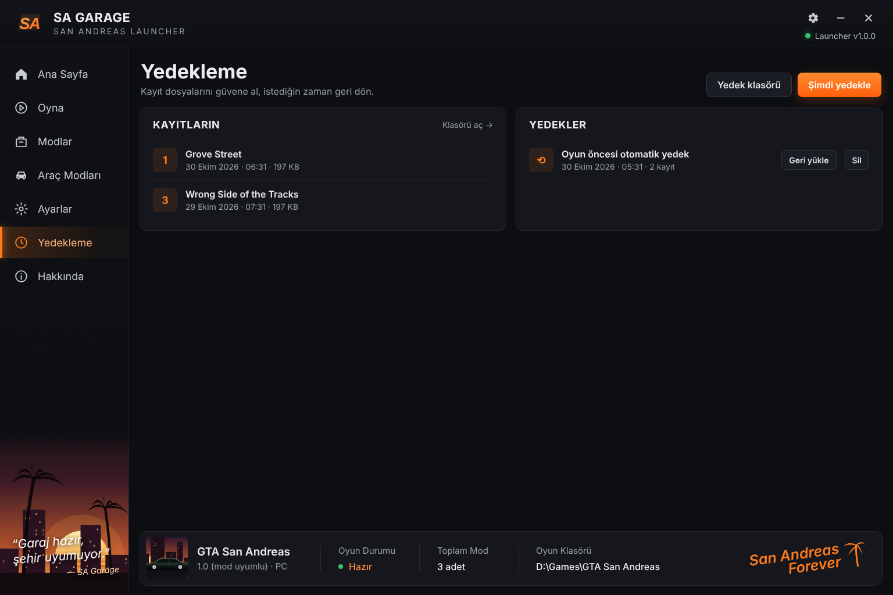

<p align="center"></p>

<h1 align="center">SA Garage</h1>
<p align="center">San Andreas için kişisel launcher: tek tıkla oyna, araç modlarını kur, kayıtlarını yedekle.</p>

<p align="center"><sub>Fikir ve tasarım: <b>Enes</b> (<a href="https://github.com/Enskygr234">@Enskygr234</a>)</sub></p>
<p align="center"><a href="../../releases/latest"><b>⬇ Windows için indir (Setup.exe)</b></a></p>

<p align="center"></p>

| | |
|---|---|
|  |  |
| Mod kütüphanesi | Oyun öncesi kontrol ve istatistikler |
|  |  |
| Ayarlar ve mod desteği | Kayıt yedekleme |

<sub>Ekran görüntülerindeki modlar ve veriler örnektir.</sub>

---

## İlk kurulum (bir kere)

1. **SA-Garage-Setup.exe**'yi indirip kur.
2. Launcher oyunu yaygın klasörlerde kendisi arar. Bulamazsa **Ayarlar → Değiştir** ile `gta_sa.exe`'nin olduğu klasörü seç.
3. **Ayarlar → Mod Desteği → Kur**'a bas. Launcher, açık kaynak **Ultimate ASI Loader** ve **Mod Loader**'ı GitHub'dan indirip oyun klasörüne kurar.
   - Oyun `C:\Program Files` içindeyse launcher'ı bir kereliğine *Yönetici olarak çalıştır*.

## Mod kurmak

1. İndirdiğin modu (`.zip`, `.rar`, `.7z` ya da klasör) launcher'a **sürükle bırak** veya **Modlar → + Mod Ekle**.
2. Launcher modu açar, içindeki `.dff` dosyalarından **hangi aracın yerine geçtiğini** bulur (ör. *Infernus yerine*) ve varsa önizleme resmini kart görseli yapar.
3. Karttaki **Kur**'a bas. Mod `modloader` klasörüne kopyalanır; oyunun orijinal dosyalarına dokunulmaz.
4. Vazgeçersen **Kurulu**'ya bas: mod oyundan çıkar, kütüphanede bekler.

İki mod aynı aracı değiştiriyorsa launcher uyarır. **Ayarlar → Modlarla oyna** anahtarını kapatırsan oyun orijinal hâliyle açılır (modlar silinmez).

## Diğer özellikler

- **Oyna**: oyun öncesi kontrol listesi, toplam oyun süresi ve oturum sayısı
- **Yedekleme**: 10 kayıt yuvasını görür, tek tıkla yedekler ve geri yükler; istersen her Oyna'dan önce otomatik yedek alır
- **Oyun ayarlarını sıfırla**: çözünürlük yüzünden oyun açılmıyorsa `gta_sa.set`'i yedekleyip kaldırır
- **Garaj günlüğü**: eklenen modlar, yedekler ve oturumlar Ana Sayfa'daki *Son Haberler*'de

## Geliştirme

```bash
npm install
npm start
npm run dist   # dist/ klasörüne Setup.exe
```

`main` dalına yapılan her gönderimde GitHub Actions Windows'ta kurulum paketini derler, launcher'ı sahte bir oyun klasörüyle dener (mod içe aktarma, mod desteği kurulumu, mod kurma) ve yeni Setup.exe'yi Releases'e yükler.

---

Bu launcher resmi değildir; Rockstar Games ile bağlantısı yoktur. Oyunun yasal bir kopyası gerekir. Mod desteği: [Mod Loader](https://github.com/thelink2012/modloader) (LINK/2012) ve [Ultimate ASI Loader](https://github.com/ThirteenAG/Ultimate-ASI-Loader) (ThirteenAG).

## Yapımcılar

- **Fikir ve tasarım:** Enes ([@Enskygr234](https://github.com/Enskygr234)) — launcher tasarımı ve özellikleri
- **Kodlama:** Claude ile birlikte
